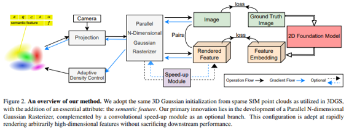
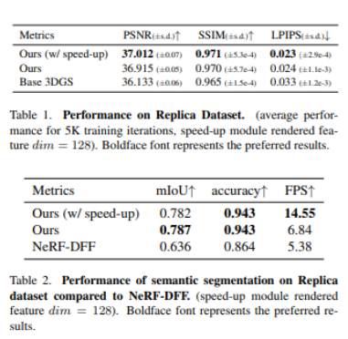
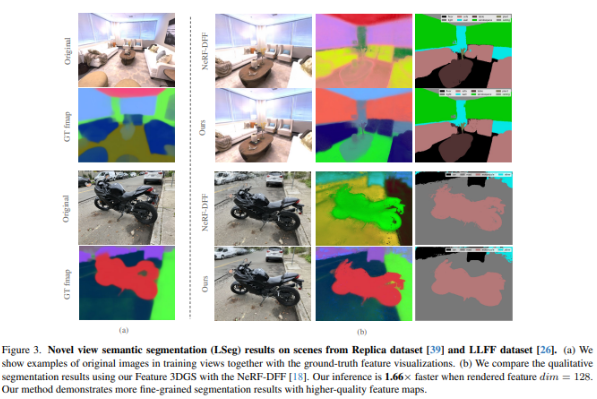
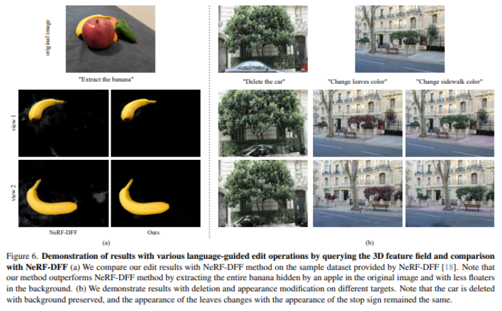

# Feature 3DGS: Supercharging 3D Gaussian Splatting to Enable Distilled Feature Fields - 논문 리뷰

## 📌 목차
1. [논문 정보](#-논문-정보)
2. [개요 (Abstract)](#-1-개요-abstract)
3. [배경 (Background)](#-2-배경-background)
4. [제안 방법 (Method)](#-3-제안-방법-method)
5. [실험 (Experiments)](#-4-실험-experiments)
6. [결론 및 아이디어 (Conclusion & Ideas)](#-5-결론-및-아이디어-conclusion--ideas)

---

## 📌 논문 정보
- **제목**: Feature 3DGS: Supercharging 3D Gaussian Splatting to Enable Distilled Feature Fields
- **학회**: CVPR 2024
- **리뷰어**: 백보성

---

## 📌 1. 개요 (Abstract)
### ✅ 연구 배경
- 3D Scene 표현 방식에는 **Implicit 방식(NeRF)** 과 **Explicit 방식(3D Gaussian Splatting, 3DGS)** 이 있음.
- **NeRF**: 고품질 렌더링 가능하지만 **느린 속도**와 **아티팩트(artifact) 문제**가 발생.
- **3DGS**: 빠른 학습과 실시간 렌더링이 가능.
- 최근 연구에서 **2D Foundation Model의 특징을 3D Feature Field로 증류**하는 시도가 있었으나, **NeRF 기반이라 속도가 느리고 최적화가 어려움**.

### ✅ 연구 목표
- **2D Foundation 모델의 의미론적 특징을 3D로 확장**하는 것이 핵심 목표.
- **3D Gaussian Splatting(3DGS) 기반 증류(Feature Distillation) 프레임워크 제안**.
- NeRF 대비 **최대 2.7배 빠른 학습 및 렌더링** 속도를 제공하며, 높은 성능을 유지.

---

## 📌 2. 배경 (Background)
### 🔹 3D Scene Representation: **NeRF vs. 3DGS**

| 방식                        | 장점                           | 단점                         |
|----------------------------|------------------------------|------------------------------|
| **NeRF (Implicit)**        | 고품질 렌더링                  | 느린 학습 및 렌더링 속도       |
| **3DGS (Explicit)**        | 빠른 렌더링 및 실시간 응용 가능 | Gaussian 표현의 노이즈 발생 가능 |

- 기존 연구에서는 **2D 모델의 특징을 3D NeRF 필드로 증류**하는 방법이 사용되었으나, **속도가 느리고 아티팩트 문제가 존재**.

---

## 📌 3. 제안 방법 (Method)
### ✅ **3D Gaussian Splatting (3DGS) + Feature Distillation**
- **Teacher-Student 구조** 적용
  - **Teacher**: 2D Foundation Model (SAM, LSeg)
  - **Student**: 3DGS 기반 모델
- **과정**
  1. **Teacher 모델**에서 2D Feature Map을 추출
  2. **Student 모델의 3D Gaussian 필드**에서 Feature Rendering 수행
  3. **Feature Loss (L1 Loss) 최소화**하여 2D-3D 특징 매칭 최적화
  4. **RGB + 의미론적 Feature 동시 최적화** 수행

  

### ✅ **속도 향상 전략 (Speed-up Module)**
- **고차원 특징을 경량 컨볼루셔널 디코더를 통해 저차원 초기화**하여 학습 속도를 증가.
- **업샘플링 네트워크를 사용해 계산량 감소** → 학습 및 렌더링 속도 증가.
- NeRF 대비 **2배 이상 빠른 렌더링 속도** 제공.

### ✅ **프롬프트 기반 3D 편집 지원**
- **SAM, LSeg 모델 활용**하여 **점/박스/텍스트 프롬프트 기반으로 3D Gaussian 특징 수정** 가능.
- 다양한 작업 지원:
  - **프롬프트 기반 3D 세그멘테이션**.
  - **특정 객체 삭제/교체/추출**.
  - **모든 뷰에서 일관성 있는 편집 결과 제공**.

---

## 📌 4. 실험 (Experiments)
### ✅ 실험 설정
- **데이터셋**: Replica, LLFF
- **비교 모델**: NeRF 기반 모델 vs. 3DGS 기반 모델
- **성능 평가 지표**: 학습 및 렌더링 속도, Feature Distillation 성능

### ✅ 주요 실험 결과
- **NeRF 대비 학습 속도 2.7배 증가**.
- **Feature Distillation을 통해 더 정확한 3D Feature Field 생성**.
- **3D 편집 및 세그멘테이션 작업에서 향상된 결과** 제공.

---

## 📌 5. 결론 및 아이디어 (Conclusion & Ideas)
### ✅ 결론
- **빠른 속도와 높은 품질의 3D Feature Field 생성 가능**.
- **2D Foundation Model의 능력을 3D로 확장**하는 새로운 접근법 제안.
- **세그멘테이션, 편집, 언어 기반 작업 모두 지원**.

### 🚀 한계점 및 향후 연구 방향
- **Teacher 모델의 한계** → 성능 상한 존재 가능.
- **Gaussian 표현의 노이즈 및 최적 파라미터 설정 문제 해결 필요**.
- **다양한 3D 응용 작업에 확장 가능성 탐색**.

---

✍️ **Written by Bosung Baek**
